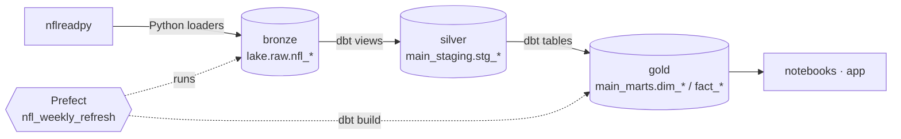
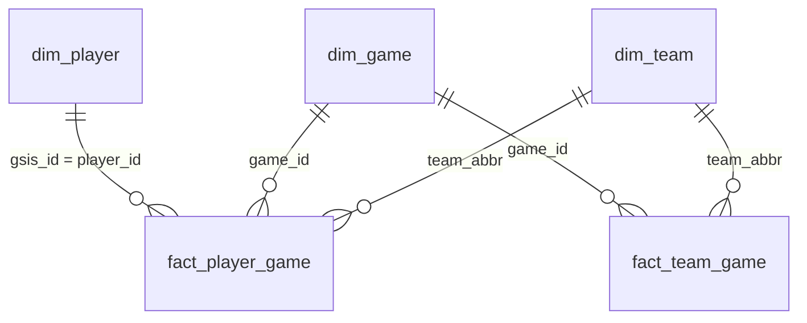

# Statline

[](https://github.com/willvernon/statline/actions/workflows/ci.yml)

NFL box scores → DuckLake → dbt star schema, refreshed weekly by Prefect. Fully local.

<!-- STAT-47: screenshot strip goes here — Prefect run + a gold query (docs/images/) -->

## How it flows



## Stack

| Piece | Choice | Why |
| --- | --- | --- |
| Extract | `nflreadpy` | Maintained nflverse loader, native Python |
| Load | Python → `lake.raw` | Source-shaped bronze, season-scoped reloads |
| Storage | DuckLake (SQL catalog + Parquet) | One sport, ~25 seasons: no cluster needed |
| Transform | dbt + `dbt-duckdb` | Tested SQL models with lineage |
| Orchestrate | Prefect (local server) | Python-native flows, no Docker |
| Monitor | Sentry | Errors + traces. Off when `SENTRY_DSN` is unset |
| Env | `uv` | One tool for Python, venv, and deps |

Started on Databricks + Delta. The data didn't justify distributed compute, so it moved local.

## The model



| Table | Grain | Key |
| --- | --- | --- |
| `fact_player_game` | one row per player per game (wide box score) | `player_id` + `game_id` |
| `fact_team_game` | one row per team per game | `team_abbr` + `game_id` |
| `dim_player` | one row per player | `gsis_id` |
| `dim_team` | one row per team | `team_abbr` |
| `dim_game` | one row per game | `game_id` |

Facts reference dims. Dims never reference each other. Rosters and draft picks stay in silver.

## Where things live

| Path | What's in it |
| --- | --- |
| `ingestion/` | DuckLake connection + one loader per raw table |
| `orchestration/` | `weekly.py` (the Prefect flow), path + Sentry setup |
| `dbt/` | Staging, core marts, fantasy marts |
| `scripts/` | `setup.py` (first run), `ingestion_runner.py` (all loaders) |
| `cli/` | Go: export one gold mart to Parquet ([docs](docs/cli.md)) |
| `docs/` | Setup, Prefect, multi-sport notes |
| `lake/` | Catalog + Parquet. Local only, gitignored |

## Status

| Built | Next | Later |
| --- | --- | --- |
| Bronze → silver → gold | `v0.1.0`: atomic reloads, grain/FK tests, CI | Multi-season backfill |
| Prefect weekly flow | Fantasy marts + web app | Live game feeds |
| Sentry for the pipeline | | [Multi-sport](docs/multi-sport-data.md) |

---

## First-time setup

Needs Python ≥ 3.13 and [uv](https://docs.astral.sh/uv/getting-started/installation/). Run everything from the repo root.

```bash
git clone https://github.com/willvernon/statline.git && cd statline
uv run python scripts/setup.py   # .env, init lake, load current season, dbt build
```

Env vars, shells, and what setup does: [docs/setup.md](docs/setup.md)

## Run Prefect

| Mode | Command |
| --- | --- |
| Run once now | `uv run python -m orchestration.weekly` |
| UI | `uv run prefect server start` → http://127.0.0.1:4200 |
| Schedule (Tue 08:00, starts paused) | `uv run python -m orchestration.weekly --serve`, then unpause `tuesday-8am` in the UI |

Profiles, the schedule, and failures: [docs/prefect.md](docs/prefect.md)

## Update data

| I want to… | Command |
| --- | --- |
| Refresh the current season | `uv run python -m orchestration.weekly` |
| Load one past season | `uv run python -m orchestration.weekly 2024` |
| Reload bronze only | `uv run python scripts/ingestion_runner.py 2024` |
| Rebuild silver + gold only | `uv run dbt build --project-dir dbt --profiles-dir dbt` ¹ |
| Query | DuckDB CLI or a notebook: `main_staging.stg_*`, `main_marts.*` |

¹ Export `LAKE_*` first: [docs/setup.md](docs/setup.md#environment)

## Troubleshoot

| Symptom | Fix |
| --- | --- |
| `Failed to reach API at http://127.0.0.1:4200` | Start `uv run prefect server start` first |
| `401 Unauthorized` from `api.prefect.cloud` | Profile points at Prefect Cloud → [docs/prefect.md](docs/prefect.md#profiles) |
| `Failed to spawn: prefect` after moving the repo | `uv sync --reinstall` |
| dbt can't attach the lake | Run from the repo root with `LAKE_*` exported |
