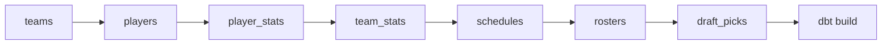

# Prefect

## Start the UI

| Step | Command (from the repo root) |
| --- | --- |
| 1. Terminal 1: server + UI | `uv run prefect server start` → open http://127.0.0.1:4200 |
| 2. Terminal 2: run the flow | `uv run python -m orchestration.weekly` |
| 3. See it | UI → **Runs** → the newest run → timeline + task runs |

Close any DuckDB query session first. An open session locks the lake ([docs/query.md](query.md)).

## The flow



`nfl_weekly_refresh` in `orchestration/weekly.py`. Any failed loader stops the flow before `dbt build`, so gold never builds on partial bronze.

| Input | Effect |
| --- | --- |
| no argument | each seasonal loader uses the current season |
| `2024` | reload that season (teams + players are always full snapshots) |

## Modes

| Mode | Terminal 1 | Terminal 2 |
| --- | --- | --- |
| Run once | `uv run python -m orchestration.weekly` | — |
| Run once, with UI history | `uv run prefect server start` | `uv run python -m orchestration.weekly` → see it at http://127.0.0.1:4200 under **Runs** |
| Scheduled | `uv run prefect server start` | `uv run python -m orchestration.weekly --serve` |

## Schedule

| Setting | Value |
| --- | --- |
| Deployment | `nfl_weekly_refresh` |
| Schedule | `tuesday-8am` (Tue 08:00, America/Indiana/Indianapolis) |
| State on create | **paused**. Unpause it in the UI at http://127.0.0.1:4200 |
| Fires only when | the `--serve` process is running |

Restarting `--serve` pauses the schedule again (STAT-82).

## Profiles

Profiles live in `~/.prefect/profiles.toml`: per user, not per repo. The flow needs one that points at the local server:

```bash
uv run prefect profile create local
uv run prefect profile use local
uv run prefect config set PREFECT_API_URL=http://127.0.0.1:4200/api
uv run prefect config view   # check PREFECT_API_URL
```

| Symptom | Cause | Fix |
| --- | --- | --- |
| `Failed to reach API at …:4200` | profile points at the local server, but it isn't running | start `uv run prefect server start` |
| `401 Unauthorized` from `api.prefect.cloud` | active profile points at Prefect Cloud | the commands above |
| UI loads but shows no runs or data | `PREFECT_SERVER_UI_API_URL` points somewhere else (e.g. a Tailscale address that isn't serving) | `uv run prefect config unset PREFECT_SERVER_UI_API_URL`, then restart the server |
| Run fails at `dbt build` | flow can't find the dbt project | check `DBT_PROJECT_DIR` in `orchestration/weekly.py` matches the `dbt/` folder |
